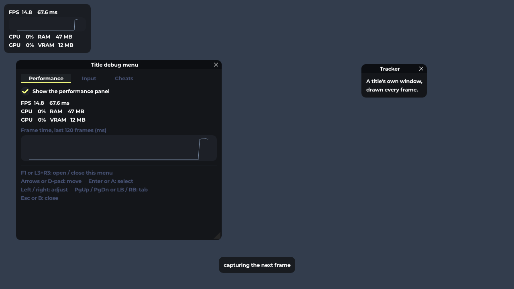

# recomp-gui-template

An F1 debug menu for recompiled Xbox Original games, built on a small immediate-mode GUI written in plain C.
Drop it into a [xboxrecomp](https://github.com/sp00nznet/xboxrecomp) game project with one command, press F1
in the running game, and get tabs, sliders, checkboxes and a live FPS / CPU / GPU / memory panel drawn over the
game. Add your own pages in a few lines.



**Runs on:** Windows (Direct3D 11), Linux (OpenGL 3.3 / ES 3.0) and macOS (Metal). Needs a C11 compiler and CMake. The
UI font is Montserrat Bold, compiled in, so the menu looks the same on every system and needs no font files.
Point `RECOMP_GUI_FONT` at any `.ttf` to use another.
Montserrat is a wide face, so the built-in one is set with its real pair kerning (read from the font's GPOS table,
which `stb_truetype` cannot do) and slightly tighter letter-spacing (`GUI_TRACKING_EM` in `src/gui.c`, default -0.025 em);
a font you supply is laid out untouched. `tools/embed_font.py` regenerates the font and kerning table from a `.ttf`.

## Quick start

```
git clone https://github.com/BearddOddity/recomp-gui-template
powershell -ExecutionPolicy Bypass -File recomp-gui-template\tools\setup.ps1 -Project "D:\My apps\My Game Recomp" -PatchCmake
```

The script reads `XBOXRECOMP_DIR` from your CMakeLists.txt (or pass `-Sdk <dir>`) and:

1. copies the GUI to `src\gui` and a starter menu to `src\debug_menu.c/.h`;
2. if the SDK has no overlay of its own, the menu is drawn by hooking `IDXGISwapChain::Present`
   (`gui_present_hook.c`), so **no SDK file is copied or patched**;
3. writes `src\gui\recomp_gui.cmake`, and with `-PatchCmake` includes it from your CMakeLists.txt.

Then add two lines to `main.c` (the call is a no-op when the menu is switched off), build and press F1:

```c
#include "debug_menu.h"
...
debug_menu_init();   // once, before the guest runs
```

Safe to re-run: existing files are kept (`-Force` overwrites). The SDK itself is never modified.

## Opt-in, and independent of the SDK version

The menu is an add-on, not part of the SDK. Configure with `-DRECOMP_GUI_MENU=OFF` and none of it is compiled or
linked: `debug_menu_init()` turns into an empty inline function, so your `main.c` needs no `#ifdef`. At run time
`RECOMP_GUI=off` hides it too. It is not tied to any SDK version:

- **Drawing:** the menu hooks `IDXGISwapChain::Present` (one patched vtable slot shared by every Direct3D 11
  swap chain), so it does not matter which SDK version or renderer made the window. If your renderer already
  calls `gui_overlay_frame_d3d11()` itself (True Crime does), skip the hook and nothing is drawn twice.
- **Pad capture:** if your runtime has `xbox_InputSetCaptured()` it is called when the menu opens; if not, the
  linker binds the name to a no-op (MSVC `/alternatename`). Either way, `gui_overlay_wants_input()` tells your own
  input code when the menu has the pad.
- **SDKs that already carry the overlay** (some forks, True Crime's checkout): the script copies only the starter
  menu, so no symbol is defined twice.
- **SDKs without an overlay** (the official sp00nznet/xboxrecomp releases I checked, up to v0.16.0): the script adds
  the GUI and the hook. It decides by looking for `src/gui` in the SDK, not by version number. Checked with a game
  built on the unmodified v0.16.0 SDK files; other versions are expected to work the same way but are untested.

If a game maps the keyboard to the pad (the SDK's keyboard option), also return "no keys" from that path while
`gui_overlay_wants_input()` is true. `setup.ps1 -PatchSdkCopies` does this by editing local copies of two SDK files, but it
depends on those files' layout, so it is off by default.
## Use cases

- Level select, cheats and god mode while bringing up a recompiled game.
- Toggling renderer features and graphics options without recompiling.
- Watching frame time, GPU and memory load while optimising.
- Settings screens and mod tools as always-on windows over the game.
- Scripted menu input for automated test runs (`gui_overlay_press`).

## Used in

| Project | What the menu does there |
|---|---|
| True Crime: New York City RE:COMPILED | Pages for audio, graphics, display, HUD layout and developer tools. Uses the same code through its SDK checkout, and its wiring is what this template follows. |
| Hulk: Ultimate Destruction recomp | A level selector. Built and tested with this template's sources: F1 opens the menu over the game. |

## Linux and macOS

Same menu, same page code; only the glue differs. The portable overlay (`gui_overlay_portable.h`) has no windowing
dependency: your window loop hands it input and draws what it returns with the OpenGL or Metal renderer.

```c
#include "gui_overlay_portable.h"
#include "gui_gl.h"        // Linux: OpenGL 3.3 core / ES 3.0, any loader (SDL, GLFW, EGL)
// #include "gui_metal.h"  // macOS: Metal

debug_menu_init();                                  // same pages as on Windows

// each frame, after drawing the scene
GuiPlatformInput in = { .focused = 1, .mouse_x = mx, .mouse_y = my, .mouse_down = { left, right },
                        .f1 = key_f1_down, .nav = { [GUI_NAV_UP] = key_up, [GUI_NAV_ACTIVATE] = key_enter, ... } };
gui_platform_set_input(&in);
const GuiDrawData *dd = gui_overlay_frame(width, height);   // NULL while off
if (dd) { gui_gl_init(SDL_GL_GetProcAddress, 0); gui_gl_render(dd, fb_w, fb_h); }          // OpenGL
// if (dd) { gui_metal_init(device, pixelFormat); gui_metal_render(dd, encoder, fb_w, fb_h); } // Metal
```

- `gui_gl_init` takes the loader your window library already has, so no GL headers or libraries are linked.
- `gui_metal_init` / `gui_metal_render` take the Metal device and the render encoder as `void *`, so the header is plain C.
- The performance panel shows FPS, frame time, CPU and RAM (no GPU numbers off Windows).
- There is no `setup.ps1` for these systems: add the folder with CMake (`add_subdirectory`) and link `recomp_gui`.
- Checked: on every push CI builds all three platforms. Linux and macOS each render the menu off screen (Mesa software OpenGL, and Metal on a macOS runner) and check that about 200,000 pixels were drawn; Linux also builds warning-free and passes portable_overlay_test. See docs/linux-opengl.png. Not yet run inside a real game window on Linux or a Mac: the window and input glue is yours to write.

## Add your own pages

```c
static void cheats(void *user) {
    gui_checkbox("God mode", &god);
    if (gui_button("Reload level")) want_reload = 1;
}
static void tracker(void *user) {
    gui_begin("Tracker", NULL, GUI_WINDOW_AUTO_RESIZE);
    gui_text("lap %d", lap);
    gui_end();
}

gui_overlay_add_page("Cheats", cheats, NULL);      // a tab in the F1 menu
gui_overlay_add_window("Tracker", tracker, NULL);  // drawn every frame
```

Callbacks run on the thread that presents. Set flags and let your game thread act on them; never block.
Widgets available: text, button, checkbox, radio, sliders, input, combo, selectable, collapsing header,
progress bar, plots and tabs (see `src/gui.h`).

Controls: F1 or L3+R3 opens and closes the menu. Arrows or D-pad move, Enter or A selects, left/right adjust,
PgUp/PgDn or LB/RB switch tab, Esc or B closes.

## Setting it up by hand

For projects the script does not fit:

1. **Add the code.** `add_subdirectory(recomp-gui-template)` and link `recomp_gui`, or copy `src/`.
2. **Register pages** once from `main()` before the first frame, as in `examples/debug_menu.c`.
3. **Draw it.** Either call `gui_present_hook_install();` once (hooks `Present`, no renderer change), or call
   `gui_overlay_frame_d3d11(device, context, backbuffer_rtv, hwnd);` yourself once per frame just before `Present()`. Not both.
4. **Pad.** Zero your port 0 pad state while the menu is open, as True Crime does:
   `if (port == 0 && gui_overlay_wants_input()) memset(&st.Gamepad, 0, sizeof st.Gamepad);`
5. **Mouse and wheel.** Skip your own mouse handling while `gui_overlay_wants_mouse()` is true, and forward
   `WM_MOUSEWHEEL` to `gui_overlay_wndproc()`.
6. **Input hook.** `src/gui_host.c` is the one place the GUI touches your runtime (see above).

**Without Direct3D 11:** use the core alone. Fill `gui_io()` each frame, call `gui_new_frame()`, your widgets,
then `gui_render()`, and draw the returned vertices, indices and scissored commands with your own renderer.

## Settings

| Variable | Effect |
|---|---|
| `RECOMP_GUI=on` or `off` | Overlay on or off (code can also call `gui_overlay_set_enabled`). |
| `RECOMP_OSD=on` or `off` | Performance panel shown or hidden at start. |
| `RECOMP_GUI_SCALE=<k>` | UI scale. Default: back-buffer height / 720, at least 1. |
| `RECOMP_GUI_FONT=<file.ttf>` | Font file. Default: the built-in Montserrat Bold. |

## What is in the repo

| Path | What |
|---|---|
| `src/gui.[ch]` | The immediate-mode core |
| `src/gui_d3d11.[ch]` | Direct3D 11 renderer |
| `src/gui_overlay.[ch]` | Performance panel, F1 menu, notices |
| `src/gui_host.[ch]` | The one hook into your runtime (input capture) |
| `src/gui_present_hook.[ch]` | Optional: draw by hooking `IDXGISwapChain::Present` |
| `src/stb_truetype.h` | Font rasteriser |
| `src/gui_font_montserrat.[ch]`, `fonts/` | The built-in Montserrat Bold with its kerning table (as C arrays), the .ttf and its licence |
| `tools/embed_font.py` | Makes `gui_font_montserrat.c` from a .ttf (needs Python and `fonttools`) |
| `examples/` | Starter F1 menu |
| `tools/setup.ps1` | The setup script |
| `src/gui_overlay_portable.[ch]` | Overlay for Linux and macOS (host feeds input, draws the result) |
| `src/gui_gl.[ch]`, `src/gui_metal.[hm]` | OpenGL and Metal renderers |
| `tests/` | `gui_smoke` (core checks), `present_hook_test` (Windows), `portable_overlay_test`, `gl_render_test` and `metal_render_test` (off-screen renders) |
| `docs/` | Screenshots made by the tests |

Build and test:

```
cmake -S . -B build && cmake --build build --config Release
build\Release\gui_smoke.exe        # prints PASS
build\Release\present_hook_test.exe  # exit code 0
```

## Where it comes from

- **[Dear ImGui](https://github.com/ocornut/imgui)** by Omar Cornut (MIT, C++) is the original design this is
  modelled on: no widget tree, one function call per widget each frame, and the call returns what the user did
  (`if (ImGui::Button("Reload"))`). This library keeps that model and naming but is written in plain C
  (`gui_button`, `gui_checkbox`, `gui_slider_float`), with C structs in place of the C++ types (`ImVec2`,
  `ImVec4` and `ImGuiStyle` became `GuiVec2`, `GuiColor` and `GuiStyle`) and no C++ compiler needed.
  It is an adaptation, not a line-by-line port: there are no tables, docking, text input, child windows or
  multiple fonts, and it adds keyboard and gamepad navigation for use over a game.
- **[Moonlight](https://github.com/Madam-Herta/Moonlight)** by Madam-Herta / deathsu is the Dear ImGui colour
  theme used as the default look. Its colours and sizes are carried over into a C `GuiStyle`
  (`gui_style_moonlight()` in `src/gui.c`, credit kept in the source) and scaled with the font size.
- **[xboxrecomp](https://github.com/sp00nznet/xboxrecomp)** by sp00nz is where this code was developed.

## License

MIT, Copyright (c) 2026 sp00nz (`LICENSE`). The code is extracted from the xboxrecomp SDK; the one change is the
input hook in `gui_overlay.c`. Third-party credits are in `NOTICE`: stb_truetype (public domain or MIT), the
Moonlight theme, the Montserrat font (SIL Open Font License 1.1, `fonts/OFL.txt`), and Dear ImGui as the design the API follows. No Dear ImGui source code is included.
